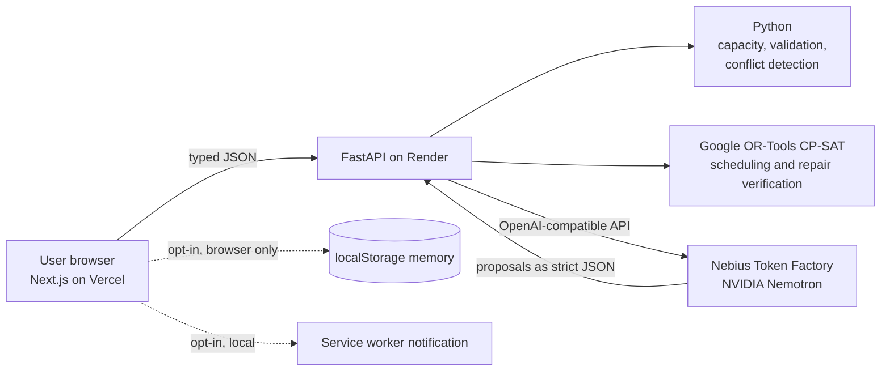

# Room for Both AI

**A capacity-aware personal planning agent that protects work and life when plans change.**

Built for the Nebius / NVIDIA hackathon, **Track: Personal AI**.

| | |
| --- | --- |
| Live application | https://room-for-both-ai.vercel.app |
| Reliability dashboard | https://room-for-both-ai.vercel.app/evaluation |
| Production API | https://room-for-both-api.onrender.com ([health](https://room-for-both-api.onrender.com/health)) |
| Repository | https://github.com/ChaitanyaJajula/room-for-both-ai |
| Track | Personal AI |
| Inference | Nebius Token Factory (OpenAI-compatible API) running `nvidia/Nemotron-3_5-Lightning` |

> The API runs on Render's free tier. If it has been idle, **the first request can cold-start and take about one minute.** Wait and retry; later requests are fast.

## The problem

People with demanding jobs and real lives do not fail at planning because they lack a calendar. They fail because a plan quietly assumes more hours than they actually have, and then one unexpected meeting breaks it. The usual reaction is to squeeze personal time (family, exercise, rest) until it disappears.

Room for Both AI is for a knowledge worker who wants to commit to work **and** protected personal time in the same week, and wants a trustworthy answer when something unexpected lands on the calendar: not a confident-sounding chat reply, but a plan that has been checked against their own limits.

## What it does

1. You set your work hours, focus windows, boundaries and protected personal time.
2. Python calculates your real weekly capacity, deterministically.
3. NVIDIA Nemotron reads the week and proposes work and personal outcomes, with explanations.
4. Google OR-Tools CP-SAT turns those outcomes into a constraint-valid schedule.
5. You review and approve the plan.
6. An unexpected meeting arrives. Python detects, deterministically, what it breaks.
7. Nemotron ranks four repair strategies: **Move, Simplify, Delegate, Drop**.
8. Python and OR-Tools validate every repair option before it is shown to you.
9. You approve the revised plan.
10. Optionally, you explicitly save, view and delete a planning preference that stays in your browser only.
11. Optionally, you explicitly send a notification to your device. No phone number or notification data is stored on the backend.
12. Anyone can open the public reliability dashboard, which runs a fixed set of deterministic evaluation cases with no model calls.

The demo uses a prepared public calendar. There are no calendar integrations and no user accounts.

## Why Nebius Token Factory and NVIDIA Nemotron are essential

Room for Both AI needs a model for the parts that are genuinely semantic: reading a week of commitments, deciding what outcomes matter for work and for life, explaining trade-offs in plain language, and ranking repair strategies for a specific disruption. Rules cannot do that well.

- **Nebius Token Factory** serves the model. The FastAPI backend calls its OpenAI-compatible endpoint (`https://api.tokenfactory.nebius.com/v1/`) with the standard `openai` Python client.
- **NVIDIA Nemotron** (`nvidia/Nemotron-3_5-Lightning`, an NVIDIA open-source model) performs the weekly analysis, proposes outcomes and explanations, and ranks repair strategies.

The model's output is treated as untrusted input. It must be strict JSON that passes validation; for the weekly analysis, any numbers in its text must also come from the verified input. If a reply fails validation, the backend makes one repair request. If that reply is also unusable, or the model is unreachable (for example no key, a timeout or an error), a deterministic fallback keeps the app working.

## AI reasoning vs deterministic verification

| Layer | Responsibility |
| --- | --- |
| **NVIDIA Nemotron** (via Nebius Token Factory) | Semantic weekly analysis, work and personal outcome proposals, plain-language explanations, ranking of repair strategies |
| **Python** | Capacity arithmetic, input validation, conflict detection, validation of model output, safety guards, fallback behavior |
| **Google OR-Tools CP-SAT** | Builds a constraint-valid schedule; verifies every repair plan before it is shown |
| **FastAPI backend** | Typed APIs and orchestration |
| **Next.js frontend** | Responsive interface, user approval, browser-local consent memory, service-worker notification |

Nemotron never decides what is valid. It does not do the arithmetic, does not detect conflicts and does not validate schedules. A repair option only reaches the screen if Python and OR-Tools have verified it.

## Architecture



More detail: [docs/ARCHITECTURE.md](docs/ARCHITECTURE.md).

## Try it in two minutes

1. Open https://room-for-both-ai.vercel.app (allow up to a minute on the first request if the API was asleep).
2. Go to **Setup**. The form is pre-filled with a prepared profile (UTC, Monday to Friday 09:00 to 17:00, a 09:00 to 11:30 focus window, 180 minutes of protected personal time and a hard Monday family dinner from 18:00 to 19:30). Keep it and choose **Review setup**.
3. Choose **Analyze my week**. The result names Nemotron as its source. If it ever says rule-based, the fallback was used.
4. Choose **Build my weekly plan**, then **Approve this plan**.
5. Choose **Add unexpected meeting**, review the conflict, read the ranked **Move / Simplify / Delegate / Drop** options and choose **Approve revised plan**.
6. Optionally choose **Remember this preference**, see it on Setup, then **Delete memory**. Optionally choose **Send phone notification** (or **Enable and send notification** if permission has not been granted yet).
7. Open https://room-for-both-ai.vercel.app/evaluation and choose **Run verified evaluation**. It needs no key and makes no model calls.

## Reliability results

The public [reliability dashboard](https://room-for-both-ai.vercel.app/evaluation) runs a fixed deterministic suite against the real code (`POST /api/v1/evaluation/run`). It makes no model calls.

| Result | Value |
| --- | --- |
| Cases passed | 6 / 6 |
| Checks passed | 59 / 59 |
| Pass rate | 100% |
| Model calls | 0 |

The cases cover capacity balance and constraint, schedule validity, conflict detection with a known overlap and a clear event, and repair-option validation.

**This is not proof of all possible correctness.** It is a fixed suite that verifies the deterministic safeguards around model output. It does not measure Nemotron's general intelligence or cover every input a user could try.

## Run it locally (Windows PowerShell)

Prerequisites: Git, Node.js with npm, and Python **3.14.8**, the version the backend was verified on. Other Python versions have not been tested.

### 1. Clone

```powershell
git clone https://github.com/ChaitanyaJajula/room-for-both-ai.git
cd room-for-both-ai
```

### 2. Backend

```powershell
cd services\api
py -m venv .venv
.\.venv\Scripts\Activate.ps1
pip install -r requirements.txt
Copy-Item .env.example .env
# Edit .env and set NEBIUS_API_KEY. Never commit .env.
uvicorn app.main:app --reload
```

The API is at http://127.0.0.1:8000 (`/health`, `/docs`). If activation is blocked: `Set-ExecutionPolicy -Scope Process -ExecutionPolicy Bypass`.

Without `NEBIUS_API_KEY` the app still runs: analysis and repair ranking use their rule-based fallbacks, and the reliability dashboard works fully.

Optional connection check (makes one real model call and needs the key):

```powershell
python -m app.services.nebius_client
```

### 3. Frontend (in a second terminal)

```powershell
cd apps\web
npm install
Copy-Item .env.example .env.local
npm run dev
```

Open http://localhost:3000. `.env.example` points the frontend at `http://localhost:8000`.

## Tests

From `services\api` with the virtual environment active:

```powershell
pytest
```

The suite uses no network and makes no model calls. 282 backend tests passed during final production preparation; run `pytest` for the current count. Frontend checks, from `apps\web`:

```powershell
npm run lint
npm run build
```

## Deployment

The backend is a Render Blueprint ([render.yaml](render.yaml), free plan) and the frontend is a Vercel project rooted at `apps/web`. The Nebius key lives only in Render's dashboard. See [docs/DEPLOYMENT.md](docs/DEPLOYMENT.md).

## Privacy

- **Planning memory** is off by default. It is saved only when you press save, kept in your browser's `localStorage`, shown in the interface, and deletable at any time. It is never sent to the backend and is not synced between devices.
- **Notifications** are sent only when you press the button and have granted browser permission. A service worker shows the notification on that device. The backend stores no phone number or notification data, and there are no scheduled push notifications.
- The backend has no database, no user accounts and no stored plans, memory or notification data. The approved plan is held in your browser tab's `sessionStorage`.
- The API key is never exposed to the browser.

## Limitations

- The demo uses a prepared public calendar. There are no calendar integrations and no accounts.
- Memory is local to one browser; clearing site data removes it.
- Notifications are one-off and manual, not scheduled.
- The evaluation suite is fixed and deterministic; it is not exhaustive.
- The free-tier backend may cold-start for about a minute after idleness.
- The public evaluation endpoint has no rate limiting.

## License

[MIT](LICENSE), copyright 2026 ChaitanyaJajula.
