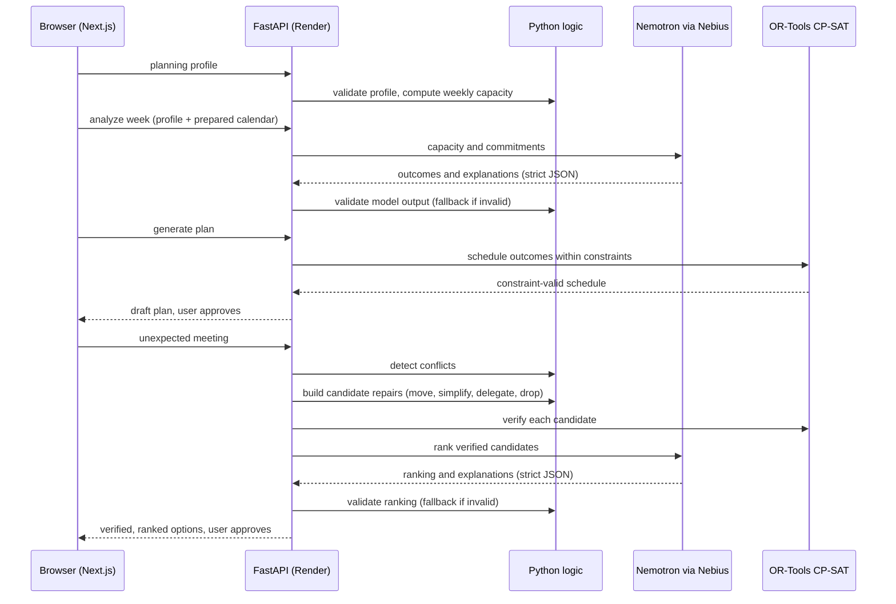
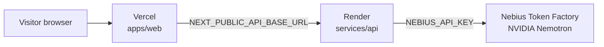

# Architecture

Room for Both AI splits work between a language model, which handles meaning, and deterministic code, which handles anything that must be correct. This page describes how the pieces fit. For the overview see the [root README](../README.md).

## Request and data flow

1. **Setup.** The user supplies work hours, focus windows, boundaries and protected personal time. Python validates the profile.
2. **Capacity.** Python calculates weekly capacity with plain arithmetic.
3. **Analysis.** Nemotron reads the capacity and the commitments from a prepared public calendar and proposes work and personal outcomes with explanations.
4. **Scheduling.** OR-Tools CP-SAT places the outcomes into a schedule that satisfies the constraints. The user reviews and approves.
5. **Conflict.** An unexpected meeting is added. Python detects, deterministically, which scheduled blocks it overlaps.
6. **Repair.** Python builds candidate repairs (Move, Simplify, Delegate, Drop) and OR-Tools verifies them. Nemotron ranks and explains only the verified options. The user approves one.
7. **Opt-in extras.** The browser may store a planning preference locally and may display a device notification, each only on an explicit click.

## Components

| Component | Technology | Responsibility |
| --- | --- | --- |
| Frontend | Next.js 16, React 19, TypeScript, Vercel | Responsive interface, approval steps, runtime validation of API responses, browser-local consent memory, service-worker notification |
| Backend | FastAPI, Pydantic v2, Render | Typed APIs and orchestration |
| Reasoning model | NVIDIA `nvidia/Nemotron-3_5-Lightning` on Nebius Token Factory (OpenAI-compatible API) | Semantic weekly analysis, outcome proposals, explanations, repair ranking |
| Deterministic logic | Python | Capacity arithmetic, validation, conflict detection, safety guards, fallback behavior |
| Scheduler | Google OR-Tools CP-SAT | Constraint-valid scheduling and repair-plan verification |
| Evaluation | Python, no model client | Fixed deterministic test cases behind the public reliability dashboard |

## Trust boundary

| Nemotron proposes | Deterministic code verifies |
| --- | --- |
| Outcomes for work and personal time | That the output is well-formed JSON of the expected shape and sensible against the computed capacity |
| Explanations in plain language | That scheduled blocks fit working hours, boundaries and protected time (OR-Tools) |
| A ranking of repair strategies | That every repair option is a valid schedule before it is displayed, and that the ranking refers only to real, verified options |

The model never computes capacity, never decides that a conflict exists and never certifies that a schedule is valid. Its output cannot reach the user unless it has passed validation. Nemotron does not perform deterministic validation anywhere in this system.

## Failure and fallback behavior

- **No key or Nebius unreachable:** analysis and repair ranking return rule-based answers, marked as such in the interface. Every other route works.
- **Malformed or invalid model output:** applies to both the weekly analysis and the repair ranking. The reply is validated (strict JSON; for analysis also outcome limits and numerical grounding; for ranking, every supplied candidate ranked exactly once and no digits in explanations). A failing reply is not partly used. One repair request is sent, and if that reply also fails, the deterministic fallback is used.
- **Request failure:** a network error, bad key, timeout or missing `NEBIUS_API_KEY` goes straight to the fallback without a repair request.
- **Fallback content:** analysis falls back to a rule-based classification and outcomes from the computed capacity. Repair ranking falls back to a fixed ordering with templated explanations. Both are marked as `fallback` and the interface says so.
- **No usable repair:** the repair API returns an explicit status (`not_needed`, `manual_resolution_required` when two fixed obligations collide, or `no_valid_options`) instead of inventing options. The scheduler reports `optimal`, `feasible`, `partial` or `infeasible`; an unexpected solver failure returns a generic error, not solver details.
- **Timeouts:** the Nebius client uses the OpenAI SDK with a 60 second timeout and one SDK retry. The frontend uses its own request timeouts (90 seconds for analysis and repair) and fixed, safe error messages.
- **Cold start:** the Render free plan may take about a minute on the first request after idleness.

## Privacy design

- No user accounts. The backend has no database or file storage and keeps no plans, memory, phone numbers or notification data; request bodies are processed and returned.
- The prepared public calendar is the only calendar source; there are no calendar integrations.
- Planning memory lives in the browser's `localStorage`, is written only on an explicit save, and can be viewed and deleted by the user. It is never sent to the backend.
- The approved plan is held in `sessionStorage` for the tab.
- Notifications are displayed locally by a service worker only after the user grants permission and presses send. No phone number is collected and nothing is scheduled.
- The Nebius API key exists only as a backend environment variable (a private value in Render's dashboard). It never reaches the frontend or the repository.
- CORS allows only the origins listed in `CORS_ALLOWED_ORIGINS`; wildcards are ignored and no credentials are sent.

## API summary

| Method and path | Purpose | Model call |
| --- | --- | --- |
| `GET /health` | Health check | No |
| `GET /api/v1/calendar/demo` | Prepared public calendar | No |
| `POST /api/v1/planning-profile/validate` | Validate a planning profile | No |
| `POST /api/v1/capacity/calculate` | Deterministic weekly capacity | No |
| `POST /api/v1/analysis/weekly` | Weekly analysis and outcomes | Yes, with fallback |
| `POST /api/v1/plan/generate` | OR-Tools schedule | No |
| `POST /api/v1/conflicts/detect` | Detect conflicts for an unexpected meeting | No |
| `POST /api/v1/repair/options` | Verified, ranked repair options | Ranking only, with fallback |
| `POST /api/v1/evaluation/run` | Deterministic reliability suite | No |

`analysis/weekly` computes capacity internally, and `repair/options` detects the conflict internally. The web interface calls the calendar, analysis, plan, repair and evaluation endpoints; the profile-validate, capacity and conflict endpoints are also available directly. The interactive OpenAPI documentation is at `/docs` on the API.

## Deployment topology

- **Vercel** hosts the frontend with `apps/web` as the root directory.
- **Render** hosts the backend from [render.yaml](../render.yaml) on the free plan.
- **Nebius Token Factory** serves Nemotron and is called only from the backend.
- The backend's `CORS_ALLOWED_ORIGINS` names the Vercel origin.

Steps and troubleshooting: [DEPLOYMENT.md](DEPLOYMENT.md).
